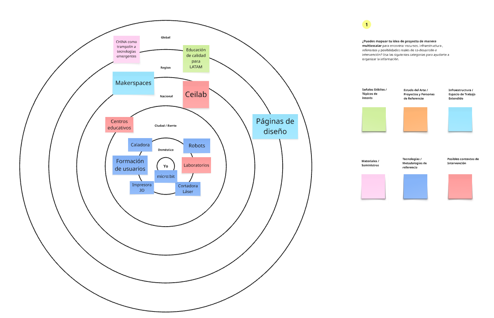
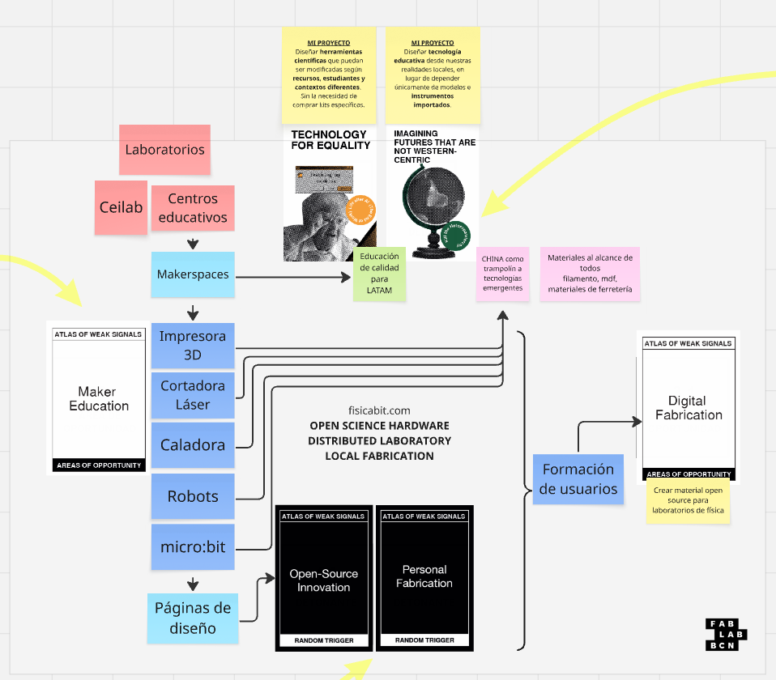
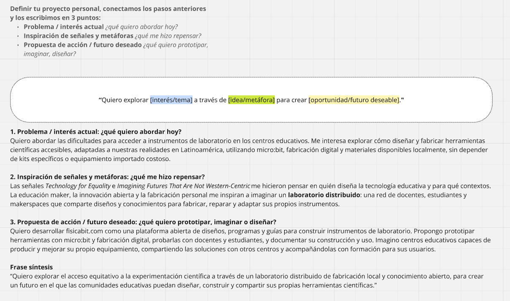

# MD01 · Módulo de Diseño: imaginar un laboratorio de física distribuido

MD01 · Especialización en Fabricación Digital e Innovación · Atlas of Weak Signals · 2026-11-08

## Brief

En este módulo trabajé sobre una pregunta que atraviesa mi práctica docente y el desarrollo de **[FisicaBit](https://fisicabit.com)**: ¿cómo ampliar el acceso a la experimentación científica sin depender exclusivamente de instrumentos comerciales costosos o de kits importados? La actividad no consistía en fabricar un producto terminado, sino en **situar una idea de proyecto dentro de su contexto**, reconocer recursos y actores, explorar señales de cambio y pensar qué futuros sería valioso construir.

Quise aprovechar el ejercicio para imaginar una red en la que docentes, estudiantes e instituciones puedan **diseñar, fabricar, adaptar, reparar y compartir** sus propios instrumentos de laboratorio, combinando micro:bit, sensores, fabricación digital y documentación abierta.

- **Usuarios y participantes**: docentes, estudiantes, laboratorios y centros educativos, especialmente aquellos con acceso limitado a equipamiento experimental.
- **Problema**: costo y disponibilidad de instrumentos, dependencia de soluciones cerradas y falta de propuestas abiertas que puedan replicarse y adaptarse a los contextos locales.
- **Restricciones y condiciones**: distintas realidades económicas e institucionales, disponibilidad variable de materiales, máquinas y conocimientos técnicos, y necesidad de que las propuestas sean accesibles y reproducibles.
- **Entregable**: mapas de contexto y relaciones, exploración de señales y una formulación escrita del proyecto y del futuro deseado.
- **Herramientas**: tablero colaborativo Miro, notas adhesivas, mapas de relaciones y tarjetas del *Atlas of Weak Signals*.

## Referencias e inspiración

Tomamos como referencia el **[Atlas of Weak Signals de Fab Lab Barcelona](https://fablabbcn.org/blog/emergent-ideas/atlas-of-weak-signals)**, una herramienta para explorar indicios de cambios que todavía no son dominantes, pero que pueden ayudar a imaginar escenarios futuros y nuevas oportunidades de diseño. Me resultó interesante porque proponía salir de la solución técnica inmediata y pensar en las transformaciones sociales, educativas y productivas con las que podría relacionarse mi proyecto.

El ejercicio proponía incorporar distintas clases de información, identificadas mediante colores: **señales o temas de interés, referencias inspiradoras, infraestructura disponible, materiales, tecnologías y posibles contextos de intervención**. Esta clasificación fue útil para evitar mirar FisicaBit únicamente como una plataforma o una colección de instrumentos.

La consigna original también está disponible como [guía visual de categorías y colores](../images/md01-modulo-de-diseno/md01-disenocontexto-aows.png). La dejo como material de consulta, sin incluirla en la galería principal, para dar más protagonismo a los mapas que elaboré durante la actividad.

También quedó como bibliografía del módulo el documento [*First Person Perspective*](../files/md01-modulo-de-diseno/first-person-perspective.pdf), que incorporo entre las referencias compartidas. La descripción de las actividades que sigue se basa en mis propios tableros y en la reflexión que escribí al finalizar el ejercicio.

## Bocetos

Mi primer trabajo fue **mapear el proyecto por escalas**, empezando por los recursos más próximos y ampliando progresivamente la mirada. En el centro situé mi relación con micro:bit y las herramientas con las que puedo experimentar. Luego aparecieron otras tecnologías y espacios: impresoras 3D, cortadoras láser, caladoras, robots, laboratorios y formación de usuarios.

Al ampliar el mapa aparecieron los **centros educativos, Ceibal, los makerspaces y las páginas de diseño**, además de cuestiones de alcance regional y global, como el acceso a materiales, el origen de las tecnologías y la necesidad de una educación de calidad en América Latina.

Este mapa me ayudó a reconocer algo importante: para construir instrumentos accesibles no alcanza con conocer la electrónica o fabricar una pieza. También necesito comprender **qué recursos existen alrededor, quién puede colaborar, dónde se puede producir y qué conocimientos hace falta compartir**.

## Iteraciones

La siguiente parte del trabajo consistió en pasar de un inventario de recursos a una **red de relaciones y oportunidades**. En el tablero conecté espacios educativos y makerspaces con tecnologías como micro:bit, impresión 3D y corte láser, y después con formación de usuarios y publicación de diseños.

Dos señales del Atlas me hicieron repensar el sentido del proyecto. **Technology for Equality** me llevó a preguntarme cómo diseñar herramientas científicas que reduzcan barreras de acceso. **Imagining Futures That Are Not Western-Centric** abrió otra pregunta: ¿por qué asumir que los instrumentos para enseñar física deben llegar siempre como productos importados y cerrados, en lugar de poder diseñarse y adaptarse desde las realidades de América Latina?

También incorporé **Maker Education** y **Digital Fabrication** como áreas de oportunidad, y relacioné **Open-Source Innovation** y **Personal Fabrication** con una forma de producción que combina ciencia abierta, conocimiento compartido y fabricación local. La idea comenzó a tomar forma como un **laboratorio distribuido**, más que como un único producto.

Esta transición fue una de las partes más valiosas: dejé de ver las herramientas de fabricación como elementos aislados y empecé a pensar en **la combinación de infraestructura, formación, documentación y colaboración** necesaria para que otras personas puedan construir y mejorar instrumentos.

No fue un proceso completamente lineal. Me costó encuadrar una propuesta tan específica de instrumentación para física dentro de las *weak signals*. Al principio, mi mirada estaba centrada en resolver una necesidad concreta del laboratorio. El ejercicio me exigió ampliar esa mirada y relacionar el proyecto con cambios que trascienden su aplicación inmediata. También reconozco que podría haber considerado otras señales para cuestionar más mis primeras elecciones.

## Resultado

El cierre del ejercicio fue sintetizar la propuesta en tres dimensiones: **el problema que quiero abordar, las señales y metáforas que me hicieron repensarlo, y la acción o futuro que quiero construir**.

- **Problema actual**: las dificultades de acceso a instrumentos de laboratorio en centros educativos, especialmente cuando dependen de equipamiento importado o costoso.
- **Inspiración**: la equidad tecnológica, los futuros pensados desde contextos no occidentales, la educación maker y el trabajo colaborativo.
- **Propuesta de acción**: continuar desarrollando FisicaBit como una plataforma abierta que reúna diseños, programas, guías y experiencias para fabricar y utilizar instrumentos de física, probarlos con docentes y estudiantes, y compartir las mejoras.

<figure class="hero-shot" markdown>

</figure>

La frase que resume esta dirección es:

> Quiero explorar el acceso equitativo a la experimentación científica a través de un laboratorio distribuido de fabricación local y conocimiento abierto, para crear un futuro en el que las comunidades educativas puedan diseñar, construir y compartir sus propias herramientas científicas.

Avance Pude identificar actores, tecnologías y espacios que pueden formar parte del proyecto, y expresar con mayor claridad qué futuro quiero contribuir a construir con FisicaBit.

Dificultad Me costó inicialmente interpretar las señales débiles desde un proyecto tan específico. No lo resolví como si fuera un ejercicio cerrado: quedó abierta la posibilidad de explorar otras señales y contrastar el mapa con personas e instituciones que puedan participar.

## Reflexión

Me pareció muy valiosa la propuesta del módulo porque me obligó a mirar más allá del dispositivo que quiero fabricar. En mi trabajo suelo partir de una necesidad bastante concreta: cómo medir una magnitud física, cómo conectar un sensor, cómo desarrollar una experiencia experimental o cómo diseñar una pieza. En esta actividad tuve que preguntarme **qué cambios de contexto podrían hacer que esas soluciones tengan mayor sentido y lleguen a más personas**.

Las *weak signals* me ayudaron a reconocer que situaciones que hoy parecen menores pueden indicar transformaciones relevantes para el futuro. Al mismo tiempo, trabajar con ellas no me resultó sencillo. FisicaBit pertenece a un campo bastante específico y, por momentos, me costaba encontrar una relación clara entre algunas señales y lo que quiero desarrollar. Esa dificultad también fue parte del aprendizaje: me permitió revisar mis supuestos y darme cuenta de que podía ampliar el análisis.

El mapa hizo visible que la disponibilidad de una impresora 3D, una cortadora láser o una placa micro:bit no alcanza por sí sola. Si queremos que un laboratorio sea verdaderamente distribuido, hacen falta **documentación comprensible, formación, diseños editables, pruebas, intercambio de experiencias y oportunidades para reparar o modificar las herramientas**. También es importante pensar en quienes no tienen acceso a estos recursos, para no reproducir nuevas barreras.

Me quedo con una idea que quiero llevar al resto de la especialización: **no se trata solamente de fabricar instrumentos más baratos, sino de generar capacidades para que las propias comunidades educativas puedan producir, comprender y mejorar su equipamiento**. En esa dirección, FisicaBit puede crecer como un proyecto de ciencia abierta y fabricación local, en el que los desarrollos se prueben con rigor y puedan reproducirse en distintos contextos.

Como próximo paso, me interesa contrastar este mapa con necesidades reales de docentes y centros educativos, definir qué instrumentos conviene prototipar primero y avanzar hacia documentación que permita su fabricación y validación fuera de mi propio laboratorio.

## Archivos

- [Atlas of Weak Signals — Fab Lab Barcelona](https://fablabbcn.org/blog/emergent-ideas/atlas-of-weak-signals) · referencia de la actividad y herramienta de exploración de futuros.
- [first-person-perspective.pdf](../files/md01-modulo-de-diseno/first-person-perspective.pdf) · bibliografía compartida para el módulo.
- [Mapa de contexto (.png)](../images/md01-modulo-de-diseno/md01-ejerciciopersonalaows2.png) · recursos y actores organizados por escala.
- [Mapa de relaciones (.png)](../images/md01-modulo-de-diseno/md01-ejerciciopersonalaows.png) · conexiones entre señales, tecnologías y oportunidades.
- [Síntesis del proyecto (.png)](../images/md01-modulo-de-diseno/md01-ejerciciopersonalaows3.png) · formulación del problema, inspiración y futuro deseado.
- [Consigna visual (.png)](../images/md01-modulo-de-diseno/md01-disenocontexto-aows.png) · categorías de trabajo y código de colores.

## Atribución y uso de IA

La actividad y los mapas se desarrollaron en un tablero colaborativo de **Miro** en el marco del módulo MD01. El enfoque metodológico y las tarjetas del *Atlas of Weak Signals* corresponden a **Fab Lab Barcelona**; las imágenes del tablero aquí utilizadas son registros de mi propia actividad formativa. El documento *First Person Perspective* se incluye como material bibliográfico del curso, sin atribuirle contenidos que no se analizan en esta entrada.

Utilicé **ChatGPT** como apoyo para organizar la bitácora, dar continuidad narrativa a los ejercicios y revisar la redacción a partir de los mapas y de mi reflexión original. Los problemas seleccionados, las relaciones propuestas, las decisiones de proyecto y las conclusiones de la actividad corresponden a mi trabajo. Para referenciar el uso de IA en contextos creativos y educativos, dejo el enlace a la [etiqueta CCL](https://santifu.github.io/ccl/).
