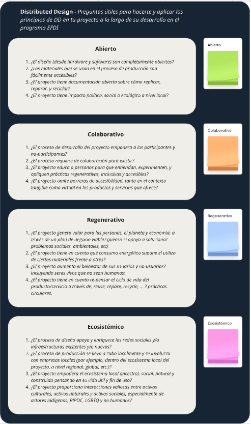
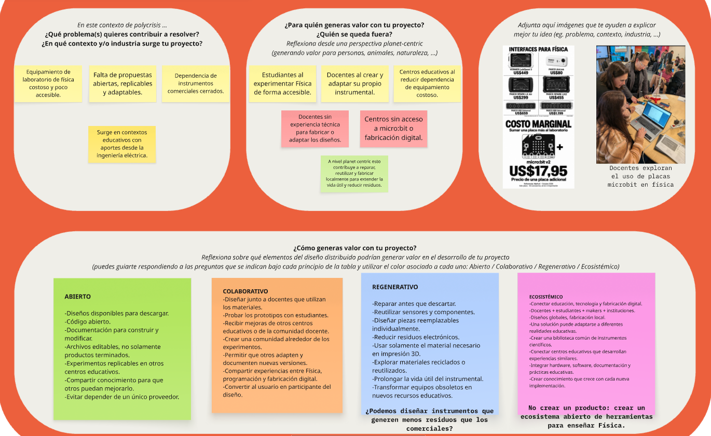

# MI01 · Innovación Abierta y Distribuida

MI01 · EFDI · Inspiración de proyectos y principios de Distributed Design

## Problema o pregunta

En esta primera actividad del módulo trabajé sobre la inspiración y la orientación de mi proyecto a partir del enfoque de **Distributed Design (diseño distribuido)**. La consigna me invitó a mirar más allá del objeto que quiero desarrollar: pensar qué problema busco resolver, para quién estoy creando valor, quiénes podrían quedar excluidos y de qué manera el diseño puede abrirse a otras personas e instituciones.

Tomé como punto de partida **FisicaBit**, un proyecto con el que busco desarrollar instrumentos y experiencias de laboratorio de física más accesibles. El problema que identifiqué tiene varias dimensiones: el equipamiento de laboratorio suele ser costoso y poco accesible, faltan propuestas abiertas que puedan replicarse y adaptarse, y muchas veces las instituciones dependen de instrumentos comerciales cerrados. Es una necesidad que encuentro en los contextos educativos y que me interesa abordar desde la enseñanza de la física, la electrónica y la fabricación digital, aprovechando también mi formación en ingeniería eléctrica.

La pregunta que me acompañó durante el ejercicio fue: **¿cómo pasar de diseñar instrumentos para mis propias experiencias a desarrollar recursos abiertos que otras personas puedan fabricar, modificar, reparar y compartir?**

## Investigación

La actividad se organizó alrededor de cuatro principios de Distributed Design: **abierto, colaborativo, regenerativo y ecosistémico**. Antes de completar el tablero, revisamos una guía de preguntas que ayudaba a relacionar estos principios con cada proyecto: la apertura del diseño y de su documentación, la participación de otras personas, el cuidado de los recursos y la articulación con el entorno.

Me resultó útil contar con preguntas concretas y con un color para cada principio. De esta manera, en lugar de quedarme con una definición general de innovación abierta, pude revisar decisiones bastante prácticas: si los archivos serán editables, si alguien podrá fabricar el instrumental sin depender de un proveedor, cómo se incorporarán las mejoras de otros docentes y qué ocurrirá cuando una pieza se rompa o quede obsoleta.

- **Primera etapa · Definir el problema.** Identifiqué el costo y la limitada accesibilidad del instrumental de física, la falta de alternativas replicables y la dependencia de sistemas comerciales cerrados.
- **Segunda etapa · Pensar para quién genera valor.** Reconocí como destinatarios a estudiantes, docentes y centros educativos, y también las barreras que podrían impedir que algunos participen.
- **Tercera etapa · Aplicar los cuatro principios.** Organicé las posibles decisiones de diseño en notas de colores para convertir las ideas generales en criterios concretos de desarrollo.

Como materiales complementarios del módulo incorporo [*Commons in Design*](../files/mi01-innovacion/commons-in-design.pdf) y [*Los caminos hacia la sostenibilidad*](../files/mi01-innovacion/los-caminos-hacia-la-sostenibilidad-scan.pdf). El segundo amplía las referencias bibliográficas que quiero considerar al seguir explorando el enfoque regenerativo y el impacto de las decisiones de diseño. Este registro se concentra en la actividad desarrollada en el tablero; no pretende resumir ni atribuir a estas lecturas las respuestas que elaboré allí.

## Ideas

Una de las partes más interesantes del ejercicio fue tener que pensar el valor del proyecto desde diferentes perspectivas. En el tablero identifiqué que **los estudiantes** podrían acceder a más oportunidades de experimentar física; **los docentes**, a la posibilidad de construir y adaptar su propio instrumental; y **los centros educativos**, a alternativas que reduzcan la dependencia de equipamiento costoso.

También aparecieron las personas e instituciones que podrían quedar fuera: docentes que no tienen experiencia técnica para fabricar o modificar diseños y centros que no disponen de micro:bit o de herramientas de fabricación digital. Reconocerlo fue importante porque un archivo disponible para descargar no garantiza, por sí solo, que una propuesta sea accesible.

### Abierto · Compartir para que otros puedan construir

Pensé en publicar **diseños descargables, archivos editables, código y documentación** que permitan construir y modificar los instrumentos. No quiero limitarme a compartir un resultado terminado, sino también los pasos, las decisiones y los conocimientos necesarios para reproducirlo. Esto permitiría que una experiencia se replique en otros centros y que las mejoras no dependan de una única persona o proveedor.

### Colaborativo · Diseñar con quienes van a utilizarlo

Me propuse considerar a los **docentes y estudiantes como participantes del proceso de diseño**, no solamente como usuarios. Eso implica probar prototipos en contextos educativos, recibir devoluciones, incorporar mejoras y permitir que otras personas documenten nuevas versiones. También abre la posibilidad de compartir experiencias entre física, programación, electrónica y fabricación digital.

### Regenerativo · Reparar, reutilizar y reducir residuos

En este punto surgieron criterios que quiero incorporar desde el comienzo: reparar antes que descartar, reutilizar sensores y componentes, diseñar piezas reemplazables por separado, evitar material innecesario en impresión 3D y explorar materiales recuperados. La idea es **prolongar la vida útil del instrumental**, incluso aprovechando equipos que hayan quedado obsoletos para otros usos.

Una pregunta que quedó planteada fue si podemos diseñar instrumentos educativos que generen menos residuos que las alternativas comerciales. Es una dirección de trabajo para investigar y comprobar, no un resultado que ya haya medido.

### Ecosistémico · Conectar personas, conocimientos y lugares

Este principio me ayudó a pensar FisicaBit como algo más amplio que una colección de instrumentos. Imaginé una **biblioteca común de recursos científicos** que conecte docentes, estudiantes, makers e instituciones, con diseños que puedan circular globalmente pero fabricarse y adaptarse de forma local. La propuesta integraría hardware, software, documentación y prácticas educativas, de manera que cada implementación pudiera aportar conocimiento a las siguientes.

La frase con la que resumí esta idea en el tablero fue: **«No crear un producto: crear un ecosistema abierto de herramientas para enseñar Física».**

## Prueba

En esta instancia la prueba no consistió en fabricar un prototipo ni en medir su funcionamiento. Fue un **ejercicio de análisis y formulación del proyecto en un tablero de Miro**. Organicé las respuestas a las consignas mediante notas adhesivas y colores, utilizando los cuatro principios como una forma de contrastar lo que ya venía desarrollando con lo que todavía sería necesario incorporar.

En la parte superior del tablero expuse el problema, a quiénes busca beneficiar el proyecto y quiénes podrían quedar excluidos. También incorporé imágenes para contextualizar el costo del instrumental y una experiencia de docentes explorando el uso de placas micro:bit en física. En la parte inferior organicé las decisiones de diseño en cuatro grupos: verde para **abierto**, naranja para **colaborativo**, azul para **regenerativo** y rosa para **ecosistémico**.

Este trabajo sirvió para hacer visibles ideas que antes estaban dispersas y para detectar aspectos que necesitan más desarrollo. Todavía queda comprobar con experiencias reales cuáles de estas decisiones son viables y qué condiciones necesitarían los centros educativos para implementarlas.

## Qué aprendí

Lo que pude clarificar El ejercicio me permitió definir mejor la dimensión abierta y distribuida de FisicaBit. Entendí que la accesibilidad no depende únicamente del precio de los componentes: también influyen la documentación, la posibilidad de editar los diseños, la disponibilidad de materiales, la capacidad de reparar el instrumental y la participación de quienes lo utilizan.

Lo que todavía debo resolver Identifiqué barreras que el diseño por sí solo no elimina. Un centro puede descargar los archivos y aun así no contar con herramientas para fabricar; un docente puede interesarse por la propuesta y no tener experiencia con electrónica o programación. Necesito pensar alternativas de acompañamiento, instrucciones claras y distintas formas de implementación para que la apertura se traduzca en posibilidades reales de uso.

Una reflexión que me llevo es que **distribuir un diseño no es lo mismo que distribuir la capacidad de utilizarlo**. Para que la propuesta tenga sentido, también hay que compartir conocimientos, contemplar distintos contextos y facilitar que otros puedan participar en su evolución.

## Próximo paso

El siguiente paso es trasladar estos criterios a las decisiones concretas del proyecto: preparar archivos editables y documentación reproducible, evaluar las necesidades de docentes y centros educativos, registrar las pruebas de los instrumentos y estudiar opciones de reparación, reutilización y fabricación local.

También me interesa avanzar hacia una organización que permita reunir y compartir versiones de los diseños, experiencias de aula y mejoras aportadas por otras personas. Mi objetivo dentro del EFDI es fortalecer el desarrollo técnico de las piezas y materiales de laboratorio, diseñarlos y probarlos con mayor rigurosidad, y facilitar que puedan fabricarse de manera descentralizada en diferentes instituciones.

Por ahora, esta primera actividad no resolvió esas cuestiones, pero sí me ayudó a **formular mejor hacia dónde quiero llevar el proyecto**: pasar de desarrollar herramientas propias a construir una propuesta que otras personas puedan reproducir, adaptar y mejorar.

## Archivos y atribución

- [Guía visual de los cuatro principios de Distributed Design](../images/mi01-innovacion/mi01-primera-actividad-referencia-de-colores-post-it.png) · preguntas de referencia utilizadas en el ejercicio.
- [Tablero de la primera actividad MI01](../images/mi01-innovacion/mi01-primera-actividad.png) · registro de las respuestas y notas organizadas en Miro.
- [*Commons in Design* (PDF)](../files/mi01-innovacion/commons-in-design.pdf) · lectura complementaria asociada al módulo.
- [*Los caminos hacia la sostenibilidad* (PDF)](../files/mi01-innovacion/los-caminos-hacia-la-sostenibilidad-scan.pdf) · bibliografía complementaria sobre sostenibilidad.

Las ideas y respuestas documentadas corresponden a mi trabajo en la actividad del módulo. La redacción y organización de esta bitácora se realizó con asistencia de IA a partir de mis capturas y explicaciones, de acuerdo con el criterio de transparencia propuesto por [CCL](https://santifu.github.io/ccl/). Las atribuciones y condiciones de uso de las imágenes de terceros incluidas como referencias en el tablero deben verificarse y respetarse antes de publicarlas fuera del contexto de la actividad.
