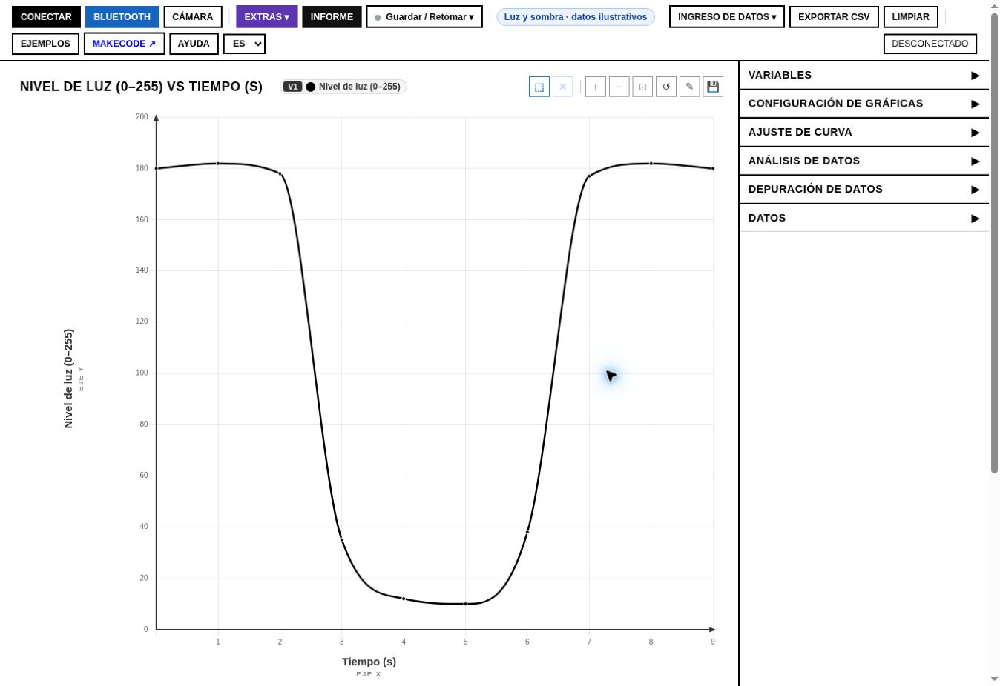
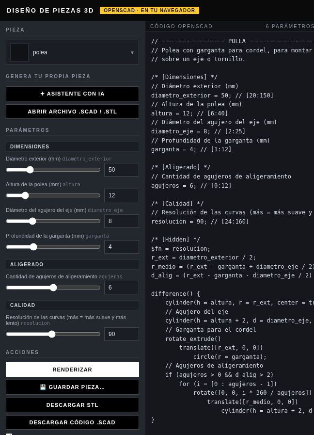
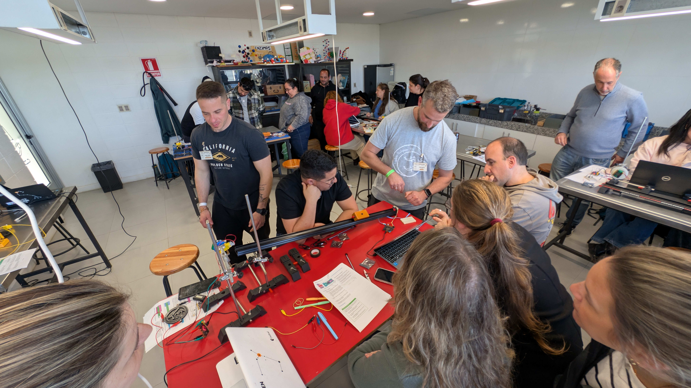

# Plantillas

<p class="meta">Una por sección · copiar, pegar y reemplazar</p>

Cada plantilla es un archivo Markdown con la estructura de la guía de documentación y los componentes para fotos del sitio. Para usarla: abrir el [editor](../editor.md), pestaña **Editar archivo**, crear la página en la carpeta de la sección y pegar el código. O copiarlo a mano en Visual Studio Code. Las fotos de ejemplo son las de la portada; se reemplazan por las propias.

!!! quote "Atribución"
    Las plantillas y los componentes para fotos fueron desarrollados con Claude (Anthropic) a pedido mío; el detalle está en el [editor](../editor.md).

!!! note "Pie de foto"
    El texto entre corchetes de cada imagen (``) es el pie de foto. Se muestra debajo en el carrete y en la galería, y como etiqueta en la comparación.

## Componentes para fotos

| Componente | Para qué | Cómo se escribe |
| --- | --- | --- |
| Carrete | Serie de fotos del proceso, una por vez, con flechas | `<div class="carrete" markdown>` + imágenes + `</div>` |
| Galería | Varias fotos a la vez en grilla (`dos` o `tres` columnas) | `<div class="galeria tres" markdown>` |
| Comparar | Antes y después, o versión 1 y 2 | `<div class="comparar" markdown>` con dos imágenes |
| Hero shot | La foto grande del resultado | `<figure class="hero-shot" markdown>` |
| Datos | Ficha con materiales, máquina, tiempo, archivos | `<div class="datos" markdown>` + lista con `**Clave**: valor` |
| Línea de tiempo | Semana a semana | `<div class="linea" markdown>` + lista con `**Semana 1** · …` |
| Video | YouTube o Vimeo, sin subir el archivo | `<div class="video"><iframe src="…"></iframe></div>` |
| Resultado | Etiqueta de éxito o fallo | `<span class="ok">éxito</span>` · `<span class="fail">falló</span>` |

Al tocar cualquier foto de estos componentes se abre en grande.

### Así se ve un carrete

<div class="carrete" markdown>






</div>

### Así se ve una galería de tres

<div class="galeria tres" markdown>


</div>

### Así se ve una comparación

<div class="comparar" markdown>


</div>

## Las plantillas

=== "Tecnología y Fabricación"

    Para una práctica con máquina: objetivo, ficha de datos, proceso en carrete, parámetros, resultados con éxito y fallo, hero shot, archivos. [Ver ejemplo](tecnologia.md).

    ````markdown
    --8<-- "plantillas/tecnologia.md"
    ````

=== "Diseño"

    Brief, referencias en galería, bocetos en carrete, iteraciones comparadas, resultado. [Ver ejemplo](diseno.md).

    ````markdown
    --8<-- "plantillas/diseno.md"
    ````

=== "Innovación"

    Problema, investigación en línea de tiempo, ideas, prueba, aprendizajes. [Ver ejemplo](innovacion.md).

    ````markdown
    --8<-- "plantillas/innovacion.md"
    ````

=== "Proyecto Integrador"

    Avance semanal: hero shot, estado, línea de tiempo, decisiones, video. [Ver ejemplo](proyecto.md).

    ````markdown
    --8<-- "plantillas/proyecto.md"
    ````

=== "Referencias"

    Un recurso: qué es, para qué me sirvió, licencia. [Ver ejemplo](referencia.md).

    ````markdown
    --8<-- "plantillas/referencia.md"
    ````
