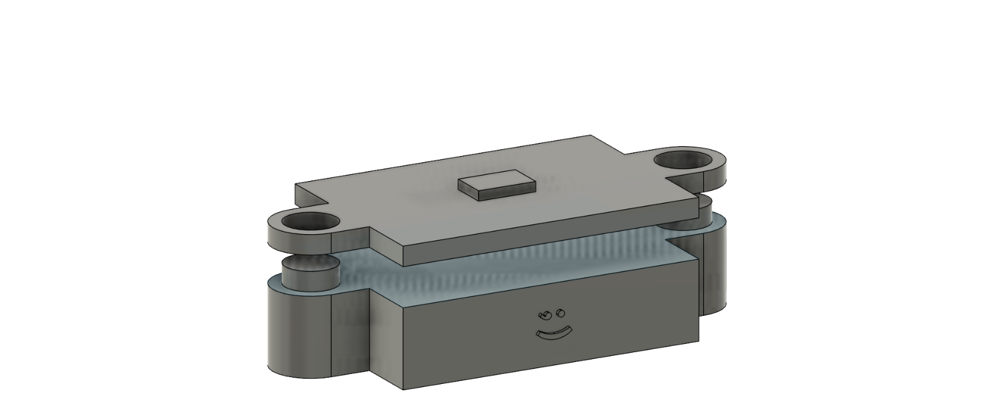
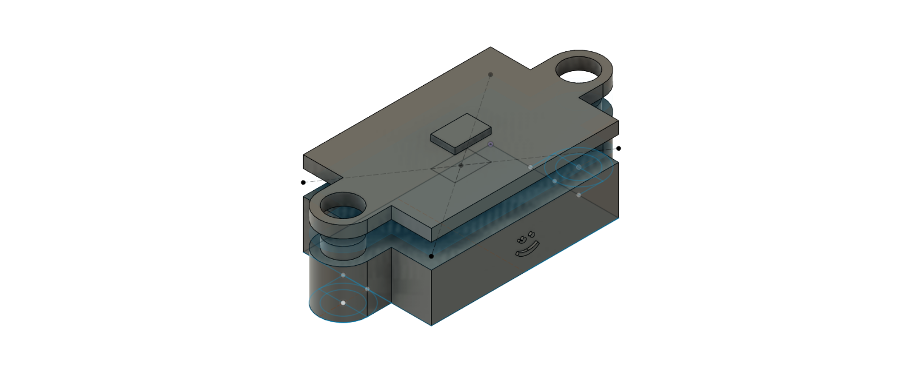
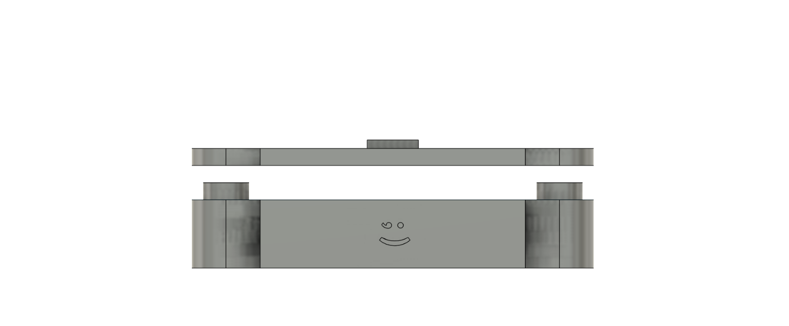
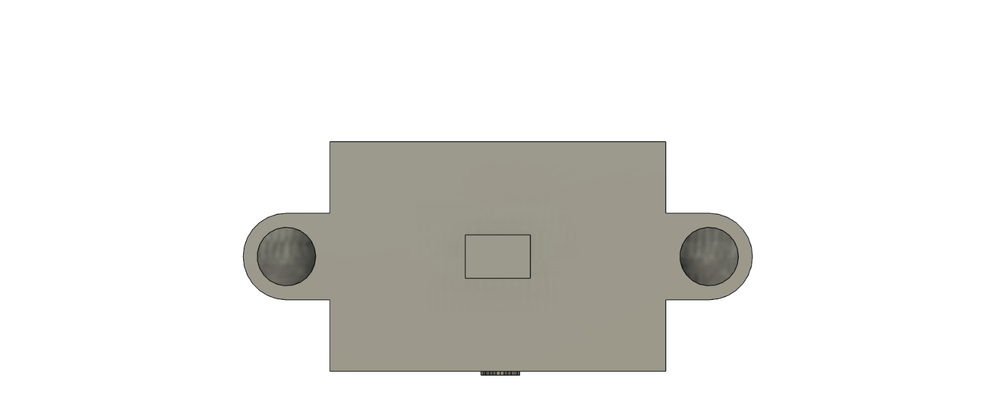
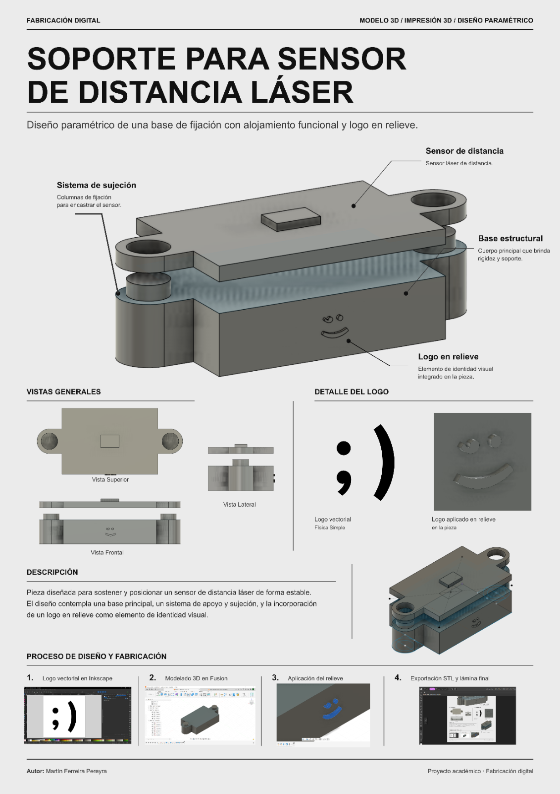

# MT02 · Soporte para sensor de distancia láser

MT02 · Tecnología y Fabricación · Diseño 3D y documentación de producto · Registro: 2026-11-08

- **Máquina / técnica**: modelado paramétrico en CAD, diseño de una pieza para impresión 3D y documentación gráfica.
- **Materiales**: pieza concebida para fabricación aditiva; material de impresión todavía no documentado.
- **Software**: Fusion 360, Inkscape y Affinity.
- **Tiempo**: no registrado.
- **Costo aproximado**: no calculado.
- **Archivos**: [ver abajo](#archivos).

## Objetivo

En este módulo me propuse diseñar un **soporte para un sensor de distancia láser**, que permitiera alojarlo y posicionarlo de forma estable mediante una pieza desarrollada en 3D. Quería aprovechar el ejercicio para trabajar no solamente el modelado en Fusion 360, sino también la manera de **presentar y documentar un diseño técnico** para que otras personas pudieran entenderlo.

## Referencias

Partí de una necesidad vinculada con el desarrollo de instrumentos para experiencias de física: contar con soportes específicos que permitan incorporar sensores a los montajes experimentales. La posibilidad de diseñar estas piezas en lugar de depender exclusivamente de accesorios comerciales forma parte del camino que busco desarrollar con FisicaBit.

Para la **presentación visual**, tomé como inspiración el lenguaje gráfico del **Bauhaus**, especialmente la claridad de las formas, la relación entre función y diseño y el uso de una composición ordenada. También me interesó la manera en que **IKEA comunica objetos y sistemas de armado**: imágenes comprensibles, detalles destacados, vistas complementarias y explicaciones breves. No buscaba reproducir una marca, sino adoptar ese criterio de comunicación directa y accesible.

Por eso decidí que el entregable final no fuera solo el modelo tridimensional. También preparé una lámina con una estética minimalista, tipografía destacada, vistas técnicas y anotaciones que permiten reconocer rápidamente las partes del soporte y el proceso seguido para diseñarlo.

## Proceso

### 1. Definición del soporte y modelado en Fusion 360

Comencé por desarrollar una pieza que pudiera servir como **base de fijación del sensor de distancia láser**. La propuesta contempla un cuerpo principal y un sistema de sujeción con apoyos laterales y orificios, además de una zona superior donde se representa la ubicación del sensor. En la lámina se muestra un volumen simplificado que permite visualizar cómo quedaría colocado sobre el soporte.

Trabajé el diseño en **Fusion 360**, organizando la geometría para que las distintas partes mantuvieran su relación funcional. El objetivo era que el sensor no quedara simplemente apoyado, sino que el soporte resolviera su ubicación y ofreciera una estructura estable. La ventaja del modelo digital es que puedo volver a modificar dimensiones, encastres y detalles cuando contraste el diseño con el sensor físico.

### 2. Identidad visual y relieve

Como parte del ejercicio también quise incorporar un elemento gráfico que identificara la pieza. Preparé en **Inkscape** el símbolo de Física Simple y lo llevé al modelo de Fusion 360 para convertirlo en un **relieve sobre una de las caras**.

Fue una oportunidad para combinar dos lenguajes distintos: un dibujo vectorial pensado en dos dimensiones y un objeto tridimensional. El logo deja de ser solamente una marca aplicada en una imagen y pasa a formar parte de la geometría del soporte.

### 3. Revisión de las vistas

Una vez definido el modelo, preparé distintas perspectivas para comprobar que la forma se comprendiera desde más de un ángulo. La vista frontal permite reconocer la base y el relieve, la superior muestra la distribución general y la lateral ayuda a interpretar la separación entre las partes y la altura del conjunto.

### 4. Diseño de la lámina de presentación

Con el modelo desarrollado, pasé a una segunda parte del trabajo que considero igual de importante: **hacer comprensible el diseño para otras personas**. En **Affinity** organicé una lámina de presentación con una vista principal grande, señalamientos de los componentes, vistas generales, el detalle del logo y una secuencia resumida del proceso de diseño.

Busqué deliberadamente una **estética minimalista inspirada en el Bauhaus y en las instrucciones visuales de IKEA**: fondo neutro, jerarquía tipográfica marcada, líneas finas que conectan las descripciones con la pieza y poco texto, pero suficiente para explicar cada decisión. La lámina no pretende ser únicamente una imagen atractiva; quiero que se convierta en un **modelo de documentación para futuras piezas de laboratorio**.

Este criterio puede ayudarme a construir una identidad visual consistente para mostrar proyectos al público, compartir archivos con docentes y estudiantes, y presentar de manera clara componentes que otras personas puedan fabricar o adaptar.

### Parámetros que usé

En este trabajo el foco estuvo en el **diseño CAD y la presentación del objeto**, no en la configuración de una máquina. Por eso registro las decisiones de modelado, en lugar de incorporar parámetros de impresión que todavía no están documentados.

| Aspecto | Decisión de diseño | Propósito |
| --- | --- | --- |
| Modelado | Fusion 360 | Desarrollar y modificar la geometría del soporte. |
| Sistema de sujeción | Apoyos laterales y orificios de fijación | Permitir un montaje estable del conjunto. |
| Ubicación del sensor | Representación simplificada sobre el soporte | Visualizar el alojamiento previsto. |
| Identificación | Logo vectorial convertido en relieve | Integrar la identidad de Física Simple a la pieza. |
| Documentación | Vistas frontal, superior, lateral e isométrica | Comunicar la forma y la función. |
| Presentación final | Lámina en Affinity | Explicar el diseño con un lenguaje gráfico consistente. |

**Pendiente de registrar:** medidas definitivas, tolerancias de encastre, material de impresión y configuración de fabricación.

## Resultados

Resultado del diseño Logré desarrollar un modelo tridimensional del soporte, incorporar el logo como relieve y preparar varias vistas para explicar sus características. También reuní el trabajo en una lámina de presentación que permite visualizar la pieza, identificar sus partes y seguir los pasos generales de su elaboración.

Aspectos por comprobar La representación digital permite evaluar la forma, pero **no demuestra por sí sola que el sensor real encastre correctamente**. Para validar la función del soporte necesito contrastar sus medidas con las del componente físico, fabricar una primera versión y verificar ajuste, estabilidad y accesibilidad para su uso en experimentos. Todavía no documento esas pruebas como realizadas.

## Hero shot

<figure class="hero-shot" markdown>

</figure>

## Reflexión

Este ejercicio me permitió entender que **diseñar una pieza y saber comunicarla son dos partes del mismo proceso**. En Fusion 360 me concentré en resolver un problema de fijación y representar un objeto funcional. En Inkscape trabajé la identidad gráfica, y en Affinity pude reunir las decisiones técnicas en una presentación más ordenada y fácil de interpretar.

La lámina final fue un resultado importante por sí mismo. Quiero mantener este estilo de documentación —minimalista, con referencias al Bauhaus y a la claridad visual de IKEA— para presentar al público otras piezas que vaya desarrollando. Mi intención es que cada diseño pueda tener una ficha clara, con su función, sus componentes, sus vistas y los archivos necesarios para comprenderlo y eventualmente reproducirlo.

También reconozco que una presentación cuidada no sustituye la validación de un prototipo. El siguiente paso es **imprimir el soporte, probarlo con el sensor real y registrar las correcciones que resulten necesarias**. Esa información permitirá transformar este primer diseño digital en una pieza comprobada y mejor documentada.

Lo conecto con el objetivo más amplio de **FisicaBit**: avanzar hacia una colección de instrumentos y accesorios educativos cuyos diseños no solo estén disponibles, sino que se puedan entender, adaptar y fabricar en distintos contextos. Para eso, la calidad de la documentación es casi tan importante como la calidad de la pieza.

## Pieza 3D

## Archivos

- [Pieza de sensor de distancia (.f3d)](../files/mt02-diseno3d/pieza-de-sensor-de-distancia.f3d) · diseño editable original de Fusion 360.
- [Pieza de sensor de distancia (.stl)](../files/mt02-diseno3d/pieza-de-sensor-de-distancia.stl) · exportación tridimensional.
- [Plantilla Affinity para soporte de sensor láser (.af)](../files/mt02-diseno3d/plantilla-affinity-soporte-sensor-laser.af) · presentación editable.
- [Sensor y soporte para sensor láser (.pdf)](../files/mt02-diseno3d/sensor-y-soporte-para-el-sensor-laser.pdf) · lámina de documentación.

## Atribución y uso de IA

El modelo, las vistas y la lámina corresponden al proceso de diseño documentado en esta práctica. La inspiración gráfica se vincula con principios del **Bauhaus** y con la claridad de la comunicación visual característica de **IKEA**, sin relación o respaldo de esas organizaciones. El logo utilizado corresponde al proyecto Física Simple.

Para la redacción y organización de esta bitácora utilicé asistencia de IA, a partir del material y la descripción de mi proceso. No atribuyo a esa asistencia el modelado de la pieza ni las pruebas físicas. Referencia para declarar el uso de IA: [CCL](https://santifu.github.io/ccl/).
