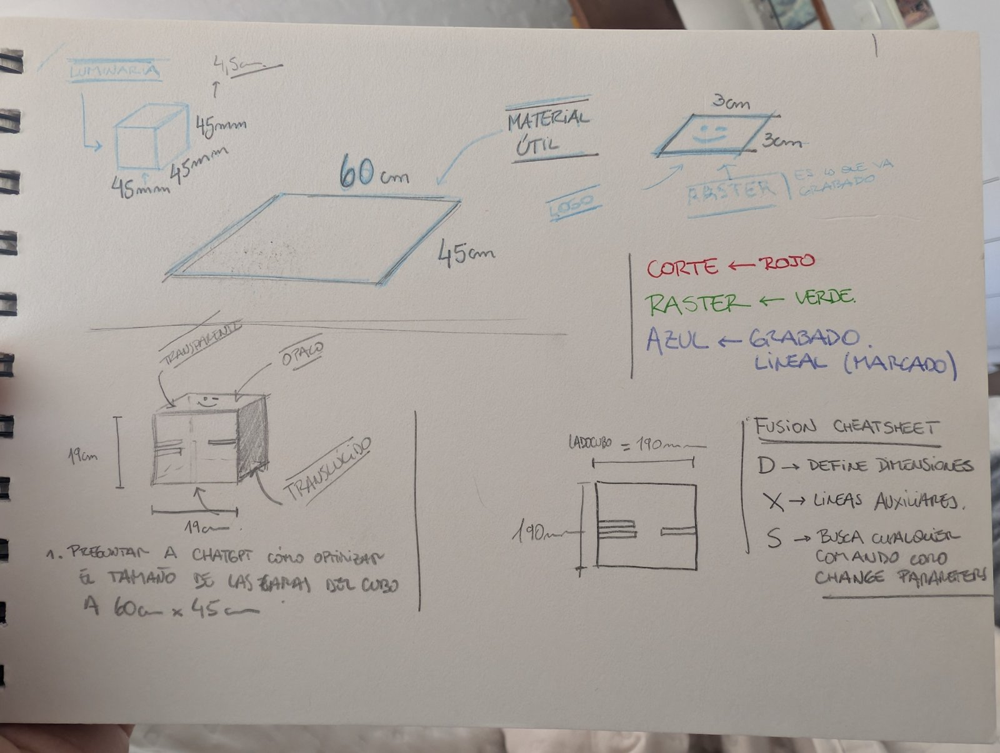
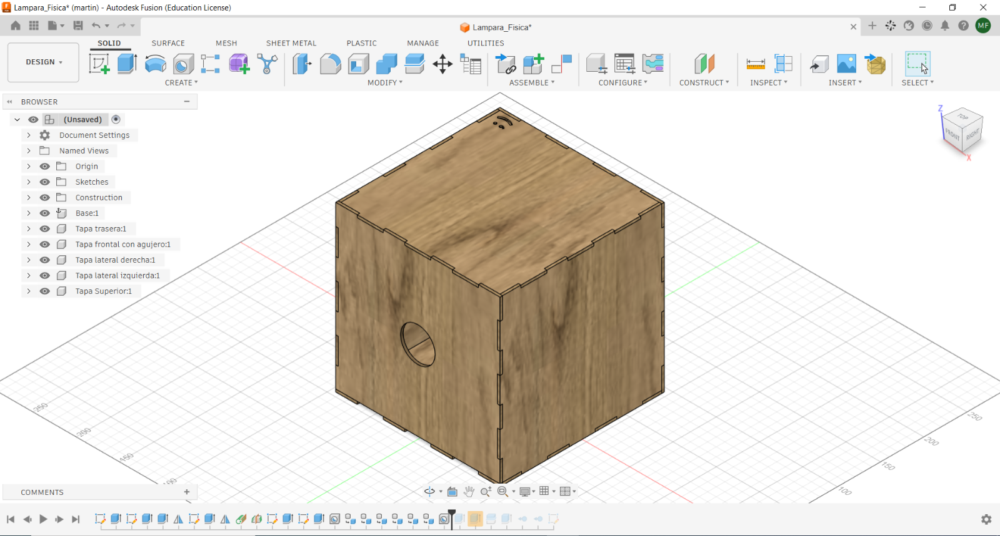
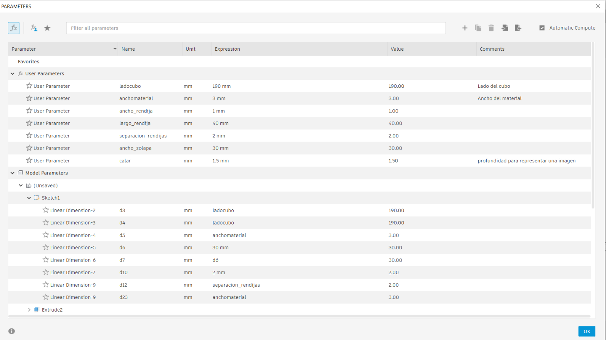
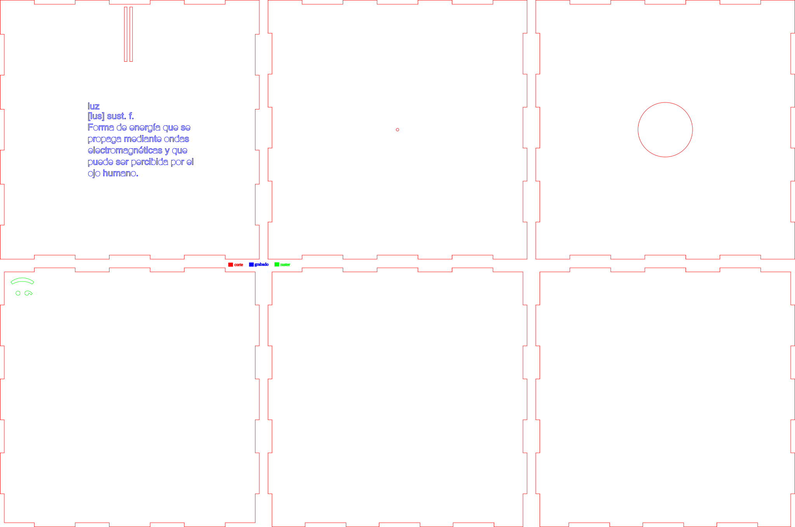
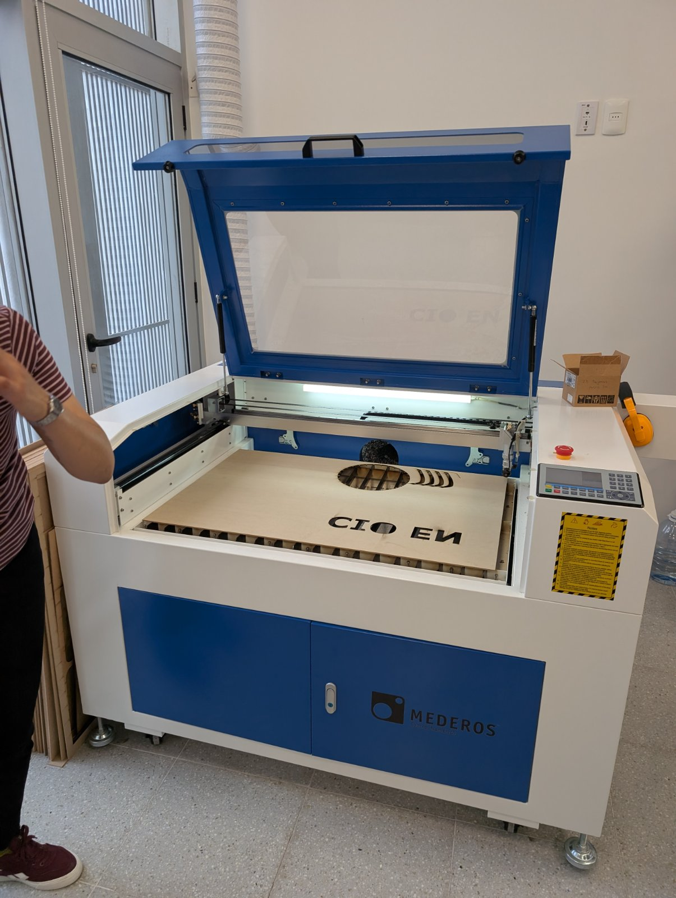
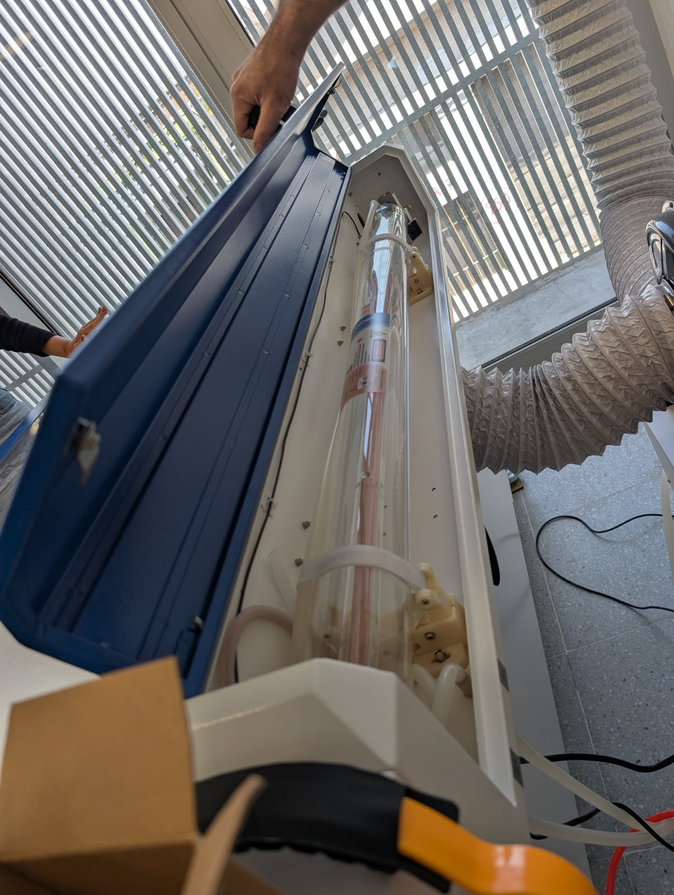
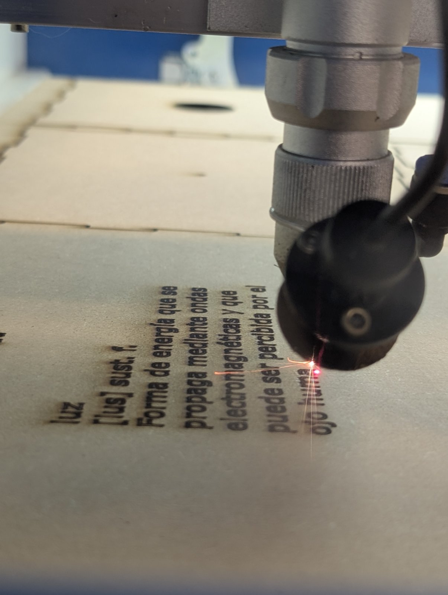

# Lámpara Física: diseñar, cortar y revelar la luz

MT03 · Tecnología y Fabricación · Módulo de corte láser · Registro de entrega: 2026-11-08

- **Máquina / técnica**: cortadora láser CO₂; corte vectorial, grabado vectorial y rasterizado.
- **Materiales**: MDF de 3 mm de espesor, definido como parámetro en Fusion 360.
- **Software**: Fusion 360, Inkscape y RDWorks V8.
- **Tiempo**: Se usaron muchas horas de trabajo en diseño.
- **Piezas usadas**: 2 planchas de 45cm x 60cm
- **Archivos**: [ver abajo](#archivos).

## Objetivo

Quise aprovechar el módulo de corte láser para desarrollar un objeto que no fuera solamente decorativo, sino que también tuviera sentido desde la enseñanza de la física. Así surgió **Lámpara Física**: una estructura cúbica, con caras encastrables y desmontables, pensada para funcionar como lámpara y, a la vez, como **cámara oscura**. Mi intención fue reunir en un mismo objeto el diseño, la fabricación digital y una experiencia vinculada con el comportamiento de la luz.

## La idea: una lámpara que también permita observar

La primera decisión fue trabajar con una caja de caras independientes, en lugar de una estructura fija. Quería que pudiera armarse y desarmarse, que cada cara tuviera una función y que el conjunto pudiera seguir evolucionando con nuevas piezas o propuestas experimentales.

El concepto de cámara oscura orientó la organización del diseño: una abertura pequeña permite controlar la entrada de luz, mientras que el interior de la caja ofrece un espacio para explorar la formación de imágenes. Para que esa experiencia funcione, será importante comprobar durante las pruebas el tamaño del orificio, el control de la luz ambiente y la superficie sobre la que se observa la proyección.

También me interesó que la pieza tuviera una lectura simbólica. Diseñé una **tapa superior desmontable con un orificio**, de manera que, al retirarla, se pudiera revelar aquello que permanece debajo, en relación con la **definición de luz grabada** en el conjunto. Ese gesto de destapar y revelar es una alegoría deliberada: la luz, desde el punto de vista físico, no solo ilumina un objeto, sino que hace posible observar y comprender lo que antes no veíamos.

## Referencias y decisiones de diseño

Tomé como punto de partida el funcionamiento de la cámara oscura y las posibilidades que ofrece una estructura modular para desarrollar experiencias educativas. También me apoyé en el trabajo con archivos vectoriales y en la preparación de operaciones diferenciadas para una cortadora láser CO₂.

Durante el diseño decidí incorporar dos elementos gráficos propios. Por un lado, el **logotipo de FisicaSimple.com**, para vincular el objeto con mi trabajo de divulgación y enseñanza de la física. Por otro, una **definición de la luz con formato de entrada de diccionario**, para que el grabado también formara parte de la experiencia conceptual.

## Proceso

### 1. Modelado en Fusion 360

Comencé por el diseño tridimensional de la estructura en **Fusion 360**. Mi intención fue crear una cámara oscura a partir del concepto de una lámpara modular: una caja cúbica con lados encastrables que pudieran montarse y desmontarse sin perder la relación entre las piezas. La tapa superior con un orificio forma parte de esa propuesta y, al retirarla, permite revelar lo que queda por debajo, junto a la definición de luz grabada. Me interesaba que la forma y el modo de interactuar con el objeto también expresaran una idea sobre la luz desde la física.

Para fabricar la estructura elegí **MDF de 3 mm de espesor**. En Fusion 360 trabajé el diseño de forma **paramétrica**, tomando ese espesor como referencia para definir las dimensiones y los encastres. Esto fue especialmente importante para que las caras coincidieran entre sí y para poder modificar el diseño con mayor facilidad si en una nueva versión cambio el material o necesito ajustar las uniones.

Diseñar las piezas por separado me obligó a revisar las medidas del cubo, la posición de las aberturas y la correspondencia de cada encastre. No buscaba producir una caja cerrada y definitiva, sino una estructura que pudiera intervenirse y reutilizarse en otras experiencias educativas. Por eso conservé el archivo editable y también exporté el modelo tridimensional para poder observar el conjunto armado.

**Modelo 3D interactivo de la Lámpara Física:**

[Descargar modelo editable de Fusion 360 (.f3d)](../files/mt03-corte-laser/lampara-fisica.f3d) · [Descargar modelo tridimensional (.stl)](../files/mt03-corte-laser/lampara-fisica.stl)

### 2. Preparación vectorial en Inkscape

Una vez resuelta la geometría, trabajé en **Inkscape** con las piezas y los elementos gráficos. Preparé los contornos de corte y los elementos que debían grabarse o rasterizarse, cuidando la correspondencia entre las caras y la posición de los encastres.

En esta etapa incorporé el logo de Física Simple y la definición de luz. El texto no fue pensado solamente como una identificación del objeto: es parte de la propuesta de la lámpara y de la relación entre la experiencia óptica y el significado físico de la luz.

Para pasar del dibujo a la máquina, organicé el archivo mediante **capas diferenciadas por color**. Esto me permitió asignar a cada elemento una operación y unos parámetros específicos en RDWorks.

### 3. Configuración de la cortadora en RDWorks V8

Importé la preparación vectorial en **RDWorks V8** y configuré por separado las operaciones. Utilicé tres capas: **roja** para el corte principal de los contornos, **negra** para el grabado vectorial y **verde** para el rasterizado. Esta separación fue fundamental para evitar aplicar a todos los trazos la misma velocidad y potencia.

#### Parámetros que usé

La tabla recoge únicamente los parámetros que varían entre las operaciones, tal como quedaron configurados en las capturas de RDWorks:

| Capa / operación | Modo en RDWorks | Velocidad | Potencia mínima | Potencia máxima |
| --- | --- | ---: | ---: | ---: |
| **Rojo · Corte de contornos** | `Cut` | 15 mm/s | 30 % | 30 % |
| **Negro · Grabado vectorial** | `Cut` | 70 mm/s | 15 % | 15 % |
| **Verde · Rasterizado** | `Scan` | 100 mm/s | 15 % | 15 % |

En el **rasterizado**, el intervalo de barrido configurado fue de **0,1 mm**. Aunque la capa negra cumple una función de grabado vectorial, en el software está configurada técnicamente en modo `Cut`; por eso mantuve esa denominación en la tabla.

Estos valores documentan **la configuración utilizada en esta práctica**, no una receta universal: su resultado depende del material, el espesor, el estado de la máquina y el enfoque del haz, entre otros factores.

[Archivo de instalación de RDWorks V8 utilizado en el módulo](../files/mt03-corte-laser/rdworksv8-20230809t215009z-001.zip)

### 4. Corte de las piezas

Con el archivo organizado y las capas configuradas, pasé a la fabricación. El corte de los contornos permitió obtener las caras y los encastres que había previsto en el modelo digital. Esta etapa es especialmente relevante para evaluar la distancia entre lo diseñado y lo que realmente produce la máquina: un encastre necesita cierta precisión para que el objeto pueda montarse sin forzar las piezas ni dejar una unión excesivamente floja.

**Registro del corte en proceso:**

<iframe src="https://drive.google.com/file/d/1J4oqGkzGYaLhZdkMADa3Jqx-nP6Laa0F/preview" title="Video del corte láser de la Lámpara Física" loading="lazy" allow="autoplay; fullscreen" allowfullscreen></iframe>

[Ver video del corte en Google Drive](https://drive.google.com/file/d/1J4oqGkzGYaLhZdkMADa3Jqx-nP6Laa0F/view?usp=drive_link)

### 5. Grabado y rasterizado

Además del corte, quise aprovechar el láser para integrar información y elementos gráficos en la pieza. La definición de luz, presentada como una entrada de diccionario, aporta una segunda lectura al objeto: más allá de su apariencia de lámpara, remite directamente al fenómeno físico que se busca explorar.

El logotipo de Física Simple completa esa identidad y conecta el trabajo del módulo con mis proyectos de recursos educativos. En la preparación de estas operaciones resultó importante distinguir un trazo vectorial de una superficie que se procesa mediante barrido, porque cada una requiere otra configuración en RDWorks.

**Registro del rasterizado en proceso:**

<iframe src="https://drive.google.com/file/d/1sLor424uDrsMr0x5cEkxz7lnSP70VbA_/preview" title="Video del rasterizado de la Lámpara Física" loading="lazy" allow="autoplay; fullscreen" allowfullscreen></iframe>

[Ver video del rasterizado en Google Drive](https://drive.google.com/file/d/1sLor424uDrsMr0x5cEkxz7lnSP70VbA_/view?usp=drive_link)

## Resultados

Avances Logré desarrollar el modelo editable en Fusion 360, preparar las caras y los elementos gráficos en Inkscape, diferenciar las operaciones por colores y documentar en RDWorks los parámetros de corte, grabado vectorial y rasterizado. Los registros fotográficos y los videos permiten mostrar esas etapas de fabricación.

Aspectos para seguir evaluando No alcanza con que la caja pueda cortarse: todavía es importante **verificar sistemáticamente** la calidad de los encastres, las tolerancias reales del material, la legibilidad del texto grabado y, especialmente, el funcionamiento óptico de la cámara oscura. No considero demostrados esos resultados experimentales únicamente por haber completado el diseño y el corte.

## Reflexión

Lo que más me interesó de este módulo fue pasar de la idea de una lámpara a un objeto que puede generar preguntas sobre la luz. El diseño de las caras encastrables me obligó a pensar no solo en la forma, sino también en el armado, la fabricación y las posibilidades de intervenir la estructura después.

La combinación de Fusion 360, Inkscape y RDWorks me permitió ver con mayor claridad que **diseñar para fabricar** implica tomar decisiones en diferentes etapas, desde parametrizar el espesor del MDF hasta configurar la máquina: modelar correctamente, preparar los vectores, asignar operaciones y comprobar los resultados sobre el material. Cada archivo cumple una función y los detalles que se dejan sin resolver en una etapa terminan apareciendo en la siguiente.

También valoro la dimensión conceptual del proyecto. La cámara oscura permite abordar la propagación de la luz a través de una experiencia tangible. Al mismo tiempo, el orificio, la tapa desmontable y la definición grabada proponen un juego entre **dejar entrar la luz, observar y revelar**. Me gustó que esa idea pudiera expresarse tanto en la función del objeto como en su diseño.

Quiero seguir mejorando esta pieza y llevarla hacia una versión más rigurosa desde el punto de vista experimental: revisar el diámetro del orificio, la superficie de proyección y las condiciones de observación; medir y ajustar los encastres; y registrar los cambios necesarios para que otras personas puedan reproducirla.

Este trabajo también se vincula con **FisicaBit** y con mi objetivo de crear materiales de laboratorio accesibles y reproducibles. La fabricación digital tiene un valor especial cuando permite diseñar un recurso, probarlo, corregirlo y compartir sus archivos para que pueda producirse en otras instituciones educativas. Esa es la dirección en la que me interesa seguir avanzando durante la especialización.

## Archivos

- [Lámpara Física (.f3d)](../files/mt03-corte-laser/lampara-fisica.f3d) · modelo original editable en Fusion 360.
- [Lámpara Física (.stl)](../files/mt03-corte-laser/lampara-fisica.stl) · modelo tridimensional exportado.
- [Plano de corte con operaciones por colores (.svg)](../images/mt03-corte-laser/dxf-para-corte-con-colores.svg) · preparación vectorial de las caras.
- [Logo de Física Simple (.svg)](../images/mt03-corte-laser/logo-fisica-simple.svg) · elemento gráfico incorporado al diseño.
- [Definición de luz (.svg)](../images/mt03-corte-laser/luzdefinicion.svg) · composición para grabado.
- [RDWorks V8 (.zip)](../files/mt03-corte-laser/rdworksv8-20230809t215009z-001.zip) · archivo del software utilizado.
- [Video del corte](https://drive.google.com/file/d/1J4oqGkzGYaLhZdkMADa3Jqx-nP6Laa0F/view?usp=drive_link) · registro del proceso.
- [Video del rasterizado](https://drive.google.com/file/d/1sLor424uDrsMr0x5cEkxz7lnSP70VbA_/view?usp=drive_link) · registro del proceso.
